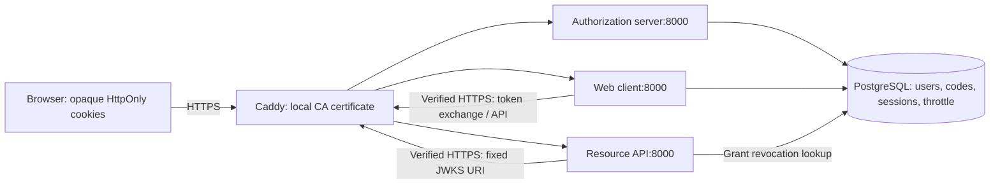

# Architecture and protocol plumbing



Caddy terminates HTTPS; backend HTTP and PostgreSQL run on one trusted Docker network. Browser-facing ports bind only to host loopback. `.test` hostnames in the hosts file map to loopback; Docker network aliases map the same names to Caddy. The issuer string is identical across discovery, signed claims, the browser and container requests. Internal names such as `auth:8000` never become token issuers.

```mermaid
sequenceDiagram
  participant B as Browser
  participant C as Web client
  participant A as Authorization server
  participant D as PostgreSQL
  participant R as Resource API
  B->>C: POST /start + form CSRF
  C->>D: Store state, nonce, verifier, deadline in browser session
  C-->>B: 303 /authorize?client_id&redirect_uri&scope&state&nonce&challenge
  B->>A: GET /authorize
  A->>A: Validate registered destination, response type, scopes and S256
  A-->>B: Login and consent forms
  B->>A: POST login + CSRF; POST consent + CSRF
  A->>D: Store hash(code) and all bindings; expires in 60s
  A-->>B: 303 registered callback?code&state
  B->>C: GET /callback
  C->>D: Lock browser session; validate and consume state transaction
  C->>A: POST /token; HTTP Basic; code + redirect_uri + verifier
  A->>D: SELECT code FOR UPDATE
  A->>A: Validate client, URI, verifier, expiry and unused state
  A->>D: Set consumed; commit before HTTP delivery
  A-->>C: Access token + ID token (openid only), no-store
  C->>A: GET fixed /jwks over verified HTTPS
  C->>C: Validate ID signature, alg, issuer, audience, expiry and nonce
  C->>D: Rotate session identifier; store tokens server-side
  B->>C: POST /notes + CSRF
  C->>R: Authorization: Bearer access-token
  R->>R: Validate access profile and notes:read scope
  R->>D: Check grant exists, consumed and not revoked
  R-->>C: Synthetic notes
  C-->>B: HTML containing notes, never tokens
```

**Who trusts whom:** the client trusts only its configured issuer and that issuer's fixed HTTPS JWKS endpoint. The API trusts that issuer for its own audience and access-token profile. The authorization server trusts a registered redirect only after exact comparison, and trusts user identity only after password verification. Consent binds that identity and the displayed scopes to the code.

**Three values with different jobs:** `state` binds the callback to the initiating browser transaction; `nonce` binds the ID token to that transaction; PKCE binds redemption to a secret verifier held by the initiating client. The client secret authenticates the registered client, rather than replacing any of those transaction checks.

**Atomicity:** redemption runs in one SQLAlchemy/PostgreSQL transaction with a row lock. A second transaction waits, then sees `consumed=true`. No token response is delivered before commit. A validly bound replay also marks the grant revoked; therefore even the winning access token becomes unusable after the race. If signing or a server error fails before commit, the transaction rolls back. A lost HTTP response after commit cannot be retried successfully; start a new flow.

**Sessions:** 256-bit random cookie identifiers are stored only as SHA-256 hashes in PostgreSQL. The actual browser state and tokens are server-side JSON. Sessions expire after 30 minutes without sliding renewal and rotate on login. One pending login per browser session is supported; starting another replaces the previous transaction. CSRF tokens are per session and rotate with it.

**Storage:** code rows contain no raw code, password rows contain Argon2id hashes, and session rows contain client tokens. Possession of the database is therefore a serious compromise. This single-host lab uses a shared database role; service-level database isolation is a future hardening task, not a claimed boundary.

**Logging:** Waitress is used without request access logs, Caddy access/runtime logs are disabled, and application log formatting omits messages. Do not enable Flask debug, SQL echo, requests wire logging, browser HAR/traces or raw request dumps during a recorded demo. Suppressing runtime details is a lab tradeoff; a production deployment needs carefully structured, redacted security audit events.

